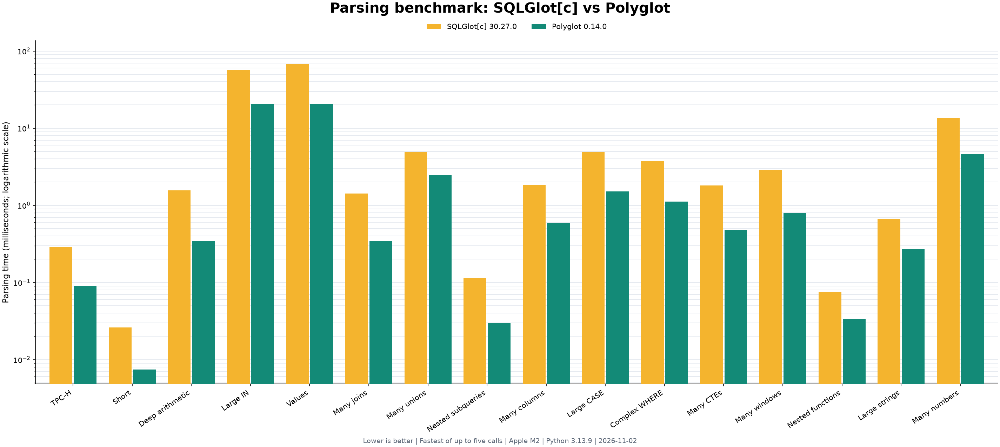
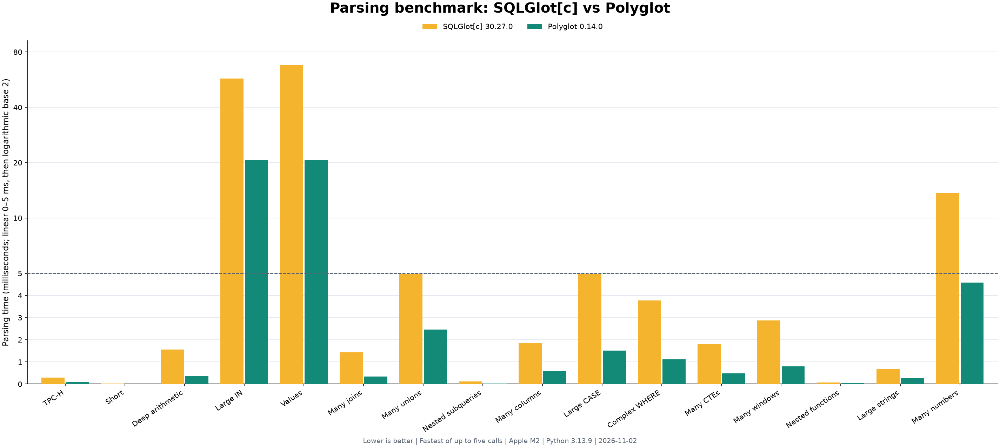
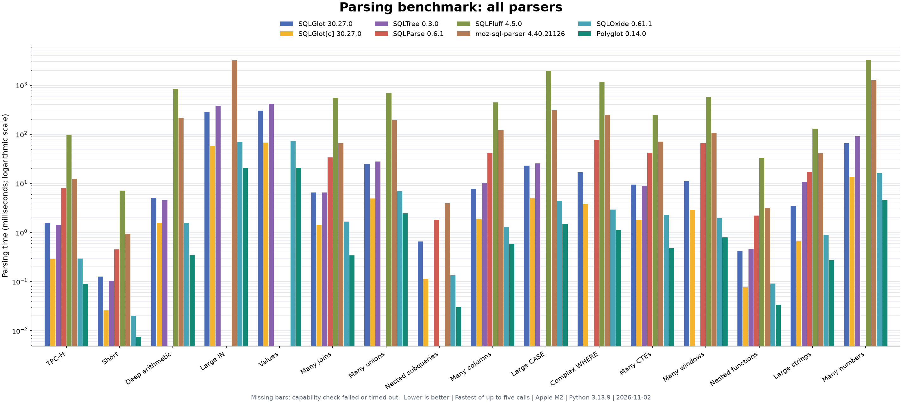
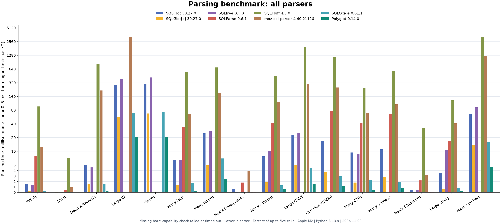
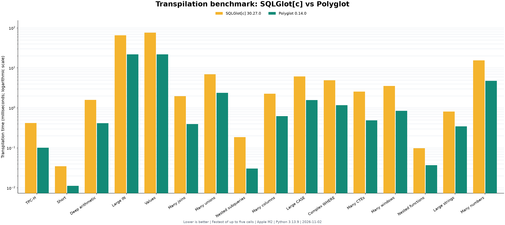
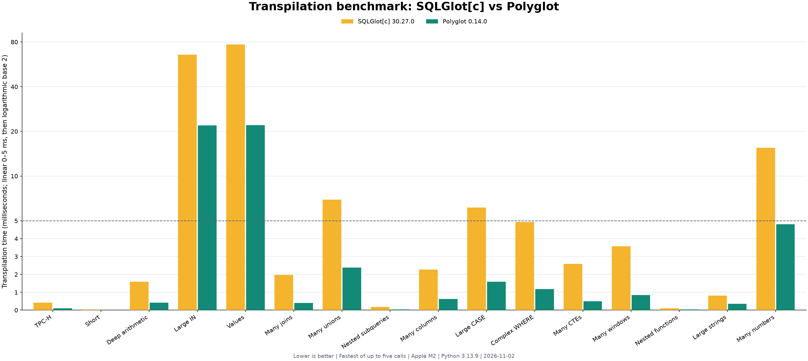

# Current Parsing Benchmarks

This report compares Polyglot 0.14.0 built from the current source branch with
SQLGlot and the other parsers registered by SQLGlot's upstream
`benchmarks/parse.py` script. Measurements were recorded on **2026-11-02**.

## Benchmark Setup

### Machine

| Component | Value |
|---|---|
| Machine | Mac mini (Mac14,3) |
| Processor | Apple M2, 8 cores |
| Memory | 16 GB |
| Architecture | arm64 |
| Operating system | macOS 27.0.1 (build 26A434) |
| Python | CPython 3.13.9 |

### Parser Versions

| Package | Version |
|---|---:|
| Polyglot | 0.14.0 |
| SQLGlot | 30.27.0 |
| SQLGlot compiled extensions (`sqlglot[c]`) | 30.27.0 |
| SQLTree | 0.3.0 |
| SQLParse | 0.6.1 |
| SQLFluff | 4.5.0 |
| moz-sql-parser | 4.40.21126 |
| SQLOxide | 0.61.1 |

Polyglot was built from commit `31b0fc6a050ad5aa80e0f9c912ee8e04f0602dd5` using the production `python_release` profile
(`opt-level=2`, thin LTO, one codegen unit), and installed as a local editable
Python package. All comparison packages use the versions pinned in
[`tools/bench-compare/uv.lock`](../tools/bench-compare/uv.lock).
SQLGlot's benchmark script and Makefile came from v30.27.0, commit
`98782638dd6dbdedebad0e6ff6edc6e69598b81e`.

The installed SQLGlot package was copied into an isolated working directory.
The upstream runner measured its compiled modules, temporarily hid that copy's
extensions to measure pure-Python SQLGlot, and restored them afterward. The
shared benchmark environment's installed extensions were not modified.

`moz-sql-parser` 4.40 imports `Iterable` from `collections`, which Python 3.13
no longer provides. A benchmark-only `sitecustomize.py` maps it to
`collections.abc.Iterable`; no parser source was modified.

### Method

The full report uses SQLGlot's unmodified upstream query corpus and runner:
16 generated stress cases covering short SQL, a TPC-H-style query, large lists,
joins, unions, CTEs, windows, nested expressions, and wide projections.

- Third-party parser/query capability checks run in separate subprocesses with
  a five-second alarm and a ten-second subprocess timeout.
- Each supported call is timed using `time.perf_counter()`; the reported value
  is the fastest of up to five calls. A call exceeding one second stops further
  repetitions for that parser/query pair.
- SQLGlot uses `parse_one(..., error_level=IGNORE)`, Polyglot uses `parse_one`,
  SQLOxide uses its ANSI dialect, and the other parsers use the functions in the
  upstream script.
- Parsing measures the selected Python API call, including returned-object
  creation, without traversing or serializing the AST. The benchmark functions
  discard their results before the timing interval ends.
- Benchmark runs execute sequentially after the native build has finished.

The separate [median-of-five report](benchmark.md) uses the same corpus and
versions but a different aggregation method; its numbers are labeled separately.

### Reproduce

From this repository, with `external-projects/sqlglot` checked out at the commit
above:

```bash
MATURIN_PEP517_ARGS='--profile python_release' \
  uv sync --project tools/bench-compare --locked --reinstall-package polyglot-sql

ROOT="$(pwd)"
PYTHON="$ROOT/tools/bench-compare/.venv/bin/python"
RUN="$(mktemp -d "$ROOT/target/current-benchmarks.XXXXXX")"
SITE_PACKAGES="$("$PYTHON" -c 'import sysconfig; print(sysconfig.get_paths()["purelib"])')"
cp -R "$SITE_PACKAGES/sqlglot" "$RUN/sqlglot"
cp "$ROOT/external-projects/sqlglot/Makefile" "$RUN/Makefile"
mkdir -p "$RUN/compat"
cat > "$RUN/compat/sitecustomize.py" <<'PYCOMPAT'
import collections
import collections.abc
collections.Iterable = collections.abc.Iterable
PYCOMPAT

(
  cd "$RUN"
  export PYTHONPATH="$RUN:$RUN/compat"
  export MAKEFLAGS="SO_BACKUP=$RUN/sqlglot-so-backup.tar"
  "$PYTHON" "$ROOT/external-projects/sqlglot/benchmarks/parse.py" \
    --quiet --json "$RUN/parse.json"
  "$PYTHON" "$ROOT/external-projects/sqlglot/benchmarks/parse.py" \
    --mode transpile --quiet --json "$RUN/transpile.json"
)
```

Recorded raw timings (seconds): [parsing](../tools/bench-compare/results/2026-11-02/parse.json),
[transpilation](../tools/bench-compare/results/2026-11-02/transpile.json), and
[environment/build metadata](../tools/bench-compare/results/2026-11-02/metadata.json).
The metadata includes source and script hashes. Regenerate all six charts with:

```bash
uv run --no-project --with matplotlib python tools/bench-compare/plot_current_benchmarks.py \
  --results tools/bench-compare/results/2026-11-02
```

## SQLGlot 30.27.0 and Polyglot 0.14.0

| Query | SQLGlot | SQLGlot[c] | Polyglot | SQLGlot / Polyglot | SQLGlot[c] / Polyglot |
|---|---:|---:|---:|---:|---:|
| TPC-H | 1.571 ms | 287.6 us | **89.9 us** | 17.48x | 3.20x |
| Short | 127.2 us | 26.1 us | **7.4 us** | 17.15x | 3.52x |
| Deep arithmetic | 5.082 ms | 1.565 ms | **347.9 us** | 14.61x | 4.50x |
| Large `IN` | 287.129 ms | 57.477 ms | **20.732 ms** | 13.85x | 2.77x |
| Values | 305.104 ms | 67.850 ms | **20.724 ms** | 14.72x | 3.27x |
| Many joins | 6.549 ms | 1.424 ms | **343.2 us** | 19.08x | 4.15x |
| Many unions | 24.859 ms | 4.958 ms | **2.466 ms** | 10.08x | 2.01x |
| Nested subqueries | 659.8 us | 113.9 us | **30.0 us** | 21.99x | 3.80x |
| Many columns | 7.747 ms | 1.843 ms | **585.1 us** | 13.24x | 3.15x |
| Large `CASE` | 22.831 ms | 4.965 ms | **1.507 ms** | 15.15x | 3.29x |
| Complex `WHERE` | 16.881 ms | 3.780 ms | **1.115 ms** | 15.14x | 3.39x |
| Many CTEs | 9.437 ms | 1.802 ms | **476.7 us** | 19.80x | 3.78x |
| Many windows | 11.068 ms | 2.866 ms | **794.2 us** | 13.94x | 3.61x |
| Nested functions | 419.2 us | 76.0 us | **33.9 us** | 12.37x | 2.24x |
| Large strings | 3.517 ms | 667.0 us | **272.1 us** | 12.93x | 2.45x |
| Many numbers | 66.143 ms | 13.636 ms | **4.579 ms** | 14.45x | 2.98x |

The geometric-mean ratios are **15.10x against pure-Python SQLGlot**
and **3.19x against SQLGlot[c]**, in Polyglot's favor.
Polyglot recorded the lowest parse time among these three implementations on
**16/16 queries**.





The focused charts compare the two native implementations. The first uses a
logarithmic millisecond axis. The hybrid view is linear from 0 through 5 ms,
then logarithmic with base-2 ticks at `5, 10, 20, 40, ...`; the dashed line marks
the transition. Lower bars indicate shorter times. Pure-Python SQLGlot remains
in the table and all-parser charts.

## All Parsers

| Query | SQLGlot | SQLGlot[c] | SQLTree | SQLParse | SQLFluff | moz-sql-parser | SQLOxide | Polyglot |
|---|---:|---:|---:|---:|---:|---:|---:|---:|
| TPC-H | 1.571 ms | 287.6 us | 1.421 ms | 8.017 ms | 96.774 ms | 12.412 ms | 294.7 us | **89.9 us** |
| Short | 127.2 us | 26.1 us | 104.5 us | 455.0 us | 7.096 ms | 942.5 us | 20.2 us | **7.4 us** |
| Deep arithmetic | 5.082 ms | 1.565 ms | 4.570 ms | N/A | 841.561 ms | 216.517 ms | 1.580 ms | **347.9 us** |
| Large `IN` | 287.129 ms | 57.477 ms | 377.124 ms | N/A | N/A | 3.184 s | 69.659 ms | **20.732 ms** |
| Values | 305.104 ms | 67.850 ms | 417.700 ms | N/A | N/A | N/A | 73.165 ms | **20.724 ms** |
| Many joins | 6.549 ms | 1.424 ms | 6.541 ms | 33.870 ms | 553.577 ms | 65.810 ms | 1.676 ms | **343.2 us** |
| Many unions | 24.859 ms | 4.958 ms | 27.917 ms | N/A | 694.322 ms | 194.561 ms | 6.970 ms | **2.466 ms** |
| Nested subqueries | 659.8 us | 113.9 us | N/A | 1.819 ms | N/A | 3.913 ms | 133.9 us | **30.0 us** |
| Many columns | 7.747 ms | 1.843 ms | 10.208 ms | 41.453 ms | 444.265 ms | 120.822 ms | 1.290 ms | **585.1 us** |
| Large `CASE` | 22.831 ms | 4.965 ms | 25.355 ms | N/A | 1.971 s | 306.169 ms | 4.418 ms | **1.507 ms** |
| Complex `WHERE` | 16.881 ms | 3.780 ms | N/A | 77.919 ms | 1.163 s | 250.504 ms | 2.934 ms | **1.115 ms** |
| Many CTEs | 9.437 ms | 1.802 ms | 8.848 ms | 42.073 ms | 245.053 ms | 70.508 ms | 2.264 ms | **476.7 us** |
| Many windows | 11.068 ms | 2.866 ms | N/A | 66.314 ms | 572.387 ms | 107.637 ms | 1.963 ms | **794.2 us** |
| Nested functions | 419.2 us | 76.0 us | 456.1 us | 2.195 ms | 33.019 ms | 3.154 ms | 91.9 us | **33.9 us** |
| Large strings | 3.517 ms | 667.0 us | 10.708 ms | 17.061 ms | 131.117 ms | 41.204 ms | 892.5 us | **272.1 us** |
| Many numbers | 66.143 ms | 13.636 ms | 91.870 ms | N/A | 3.269 s | 1.255 s | 16.139 ms | **4.579 ms** |





The all-parser charts use the same logarithmic and hybrid scales described
above. Polyglot recorded the lowest time among measured parsers on
**16/16 queries**. Against SQLOxide, which also completed all 16 queries, the
geometric-mean ratio was **3.29x in Polyglot's favor**. Capability coverage was:

| Parser | Completed queries |
|---|---:|
| SQLGlot | 16/16 |
| SQLGlot[c] | 16/16 |
| SQLTree | 13/16 |
| SQLParse | 10/16 |
| SQLFluff | 13/16 |
| moz-sql-parser | 15/16 |
| SQLOxide | 16/16 |
| Polyglot | 16/16 |

Missing bars and `N/A` cells indicate an error or timeout during capability
discovery. They are not measured parse times and do not imply a correctness
comparison between parsers.

## Transpilation

The same upstream runner's `--mode transpile` calls SQLGlot through
`transpile(..., error_level=IGNORE)[0]` and Polyglot through `transpile(...)[0]`.
All three measured implementations completed all 16 queries. This uses the
same fastest-of-up-to-five timing method and package versions as parsing.
No explicit source or target dialect is supplied, so this measures the default
parse-plus-SQL-generation path rather than a particular cross-dialect rewrite.

| Query | SQLGlot | SQLGlot[c] | Polyglot | SQLGlot / Polyglot | SQLGlot[c] / Polyglot |
|---|---:|---:|---:|---:|---:|
| TPC-H | 2.096 ms | 421.7 us | **102.1 us** | 20.53x | 4.13x |
| Short | 155.3 us | 34.9 us | **11.3 us** | 13.70x | 3.08x |
| Deep arithmetic | 6.129 ms | 1.597 ms | **417.2 us** | 14.69x | 3.83x |
| Large `IN` | 311.853 ms | 65.701 ms | **21.975 ms** | 14.19x | 2.99x |
| Values | 333.098 ms | 76.852 ms | **21.988 ms** | 15.15x | 3.50x |
| Many joins | 8.655 ms | 1.968 ms | **395.7 us** | 21.87x | 4.97x |
| Many unions | 32.420 ms | 6.940 ms | **2.387 ms** | 13.58x | 2.91x |
| Nested subqueries | 922.8 us | 187.6 us | **30.6 us** | 30.17x | 6.13x |
| Many columns | 8.999 ms | 2.276 ms | **628.1 us** | 14.33x | 3.62x |
| Large `CASE` | 26.359 ms | 6.143 ms | **1.583 ms** | 16.65x | 3.88x |
| Complex `WHERE` | 20.330 ms | 4.925 ms | **1.182 ms** | 17.20x | 4.17x |
| Many CTEs | 12.691 ms | 2.585 ms | **493.2 us** | 25.73x | 5.24x |
| Many windows | 13.916 ms | 3.573 ms | **849.1 us** | 16.39x | 4.21x |
| Nested functions | 463.5 us | 98.5 us | **37.0 us** | 12.51x | 2.66x |
| Large strings | 3.863 ms | 814.0 us | **347.2 us** | 11.12x | 2.34x |
| Many numbers | 70.886 ms | 15.492 ms | **4.801 ms** | 14.76x | 3.23x |

The geometric-mean ratios are **16.44x against pure-Python SQLGlot**
and **3.69x against SQLGlot[c]**, in Polyglot's favor.
Polyglot recorded the lowest transpilation time on **16/16 queries**.





The focused transpilation charts use the same logarithmic and linear-then-log
scales as the parsing charts.

## Interpretation

These tools perform different work and accept different syntax. SQLParse is
primarily a non-validating parser/tokenizer, SQLFluff performs richer structural
work, and parsers differ in error recovery, dialect defaults, and AST creation.
The benchmark measures specific public calls, not equivalent correctness or
feature coverage. Ratios are geometric means of per-query ratios, with every
query weighted equally.

Fastest-of-five timings describe best-case latency for this machine and corpus.
They do not provide confidence intervals, cold-start cost, memory usage, or
concurrent throughput. Parsing excludes downstream AST use and SQL generation;
the transpilation section includes SQL generation. The machine was a normal
interactive development environment. Versions, OS, and installation method differ
from the previous report, so these results are not a controlled before/after
measurement of Polyglot's recent optimizations.
